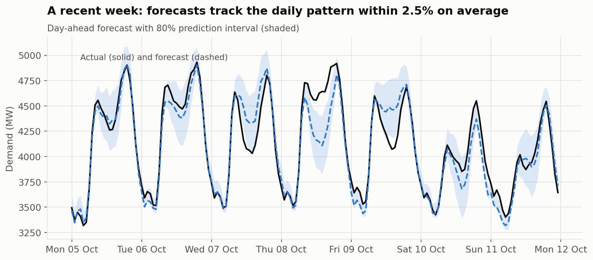

# Irish Electricity Demand: Growth, Wind and Day-Ahead Forecasting

An automated, reproducible analysis of the Irish power system using **EirGrid** grid data
(hourly demand, wind generation, carbon intensity, 2019 to today) and **Met Éireann** weather,
with a **day-ahead demand forecast** tested honestly against the industry-standard benchmark.

**[Read the report →](https://bymankirat.github.io/ireland-electricity-demand/)**



> Independent analysis. Not an EirGrid or ESB publication.

## What it does

1. **Downloads** 15-minute demand, wind and CO2 data from the EirGrid Smart Grid Dashboard (cached
   month by month) and hourly temperature from Met Éireann.
2. **Cleans** it onto one hourly Irish-time table, handling clock changes (the repeated autumn hour is
   averaged, the missing spring hour filled) and filling only gaps of up to 3 hours.
3. **Checks quality** automatically: coverage, plausible ranges, stuck values, sudden jumps,
   freshness, weather matching. A failure stops the run (`reports/qc_log.txt`).
4. **Analyses** demand growth, winter evening peaks, wind share and the wind-carbon relationship.
5. **Forecasts tomorrow's demand** at midnight, hour by hour, using only information available then:
   recent demand, calendar, **Irish public holidays** (computed from the official rules) and temperature.
6. **Tests honestly:** trained on 2019-2023 (first COVID-19 lockdown excluded), model chosen on 2024,
   judged once on 2025 onwards. Compared with "same hour last week", the standard benchmark.
7. **Quantifies uncertainty:** 80% prediction intervals from validation-year errors, with coverage
   checked on the test period.
8. **Publishes** a plain-English report for an electricity-company audience to `docs/index.html`.

## Run it

```bash
pip install -r requirements.txt
python run_pipeline.py            # first run downloads ~7 years of data (5-10 minutes)
python run_pipeline.py --refresh  # monthly update
```

## Structure

```
run_pipeline.py      download -> QC -> analysis -> forecasts -> charts -> report
src/data.py          EirGrid + Met Éireann download, time zones, clock changes, hourly table
src/holidays.py      Irish public holidays, incl. substitutions and St Brigid's Day
src/quality.py       automatic quality checks and log
src/analysis.py      growth, peaks, daily profiles, wind and carbon
src/forecast.py      features, benchmark, ridge regression, gradient boosting, intervals
src/charts.py        figures
src/report.py        report page
```

Data: EirGrid Smart Grid Dashboard; Met Éireann (CC BY 4.0). Mankirat Singh ·
[Portfolio](https://bymankirat.github.io/myportfolio/) · [LinkedIn](https://linkedin.com/in/mankirat-singh-694440177)
